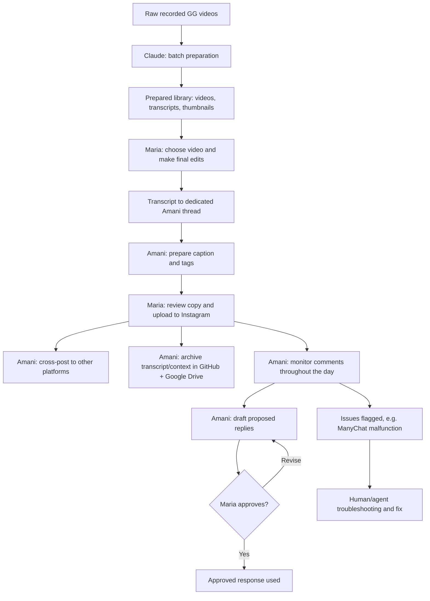

# Case 001 — AI-assisted content production, publishing & engagement

> **Maria Blair AI Consulting · AI Leverage Case Library**  
> **Business:** Glorious Goddess (GG), a founder-led content brand  
> **Documented example:** November 19, 2026  
> **Status:** Operational workflow; early benefits observed  
> **Audience:** Solo founders, coaches, creators, and lean marketing teams

## Executive snapshot

**Problem:** Publishing short-form videos consistently required a fragmented set of manual activities: video processing, transcripts, thumbnail preparation, editing, caption writing, cross-posting, archiving, community monitoring, and comment responses. For a founder balancing several projects and family commitments, that was difficult to sustain.

**Solution:** A human-directed, multi-agent content workflow. Claude prepares video assets in batches; Maria selects and approves content and publishes on Instagram; Amani prepares captions and tags, handles downstream cross-posting and archiving, monitors comments, drafts responses, and flags workflow issues.

**Observed result:** On November 19, Maria selected one video from a library of approximately **10 preprocessed videos** and made minor edits in about **3 minutes**. That figure represents the **editing step only**, not total daily publishing time. The broader workflow also handled distribution, transcript archiving, and assisted community management.

**Key principle:** Automation amplifies the founder's creative direction; it does not replace her responsibility for messaging, quality, approvals, or business strategy.

## 1. The original problem

Without a coordinated workflow, daily posting involved multiple disconnected steps:

1. Find a suitable recorded video.
2. Edit it for publication.
3. Produce and verify a transcript.
4. Prepare thumbnail treatment.
5. Write a caption and select hashtags.
6. Upload to Instagram.
7. Publish or distribute to additional platforms.
8. Archive the transcript and project context.
9. Check incoming comments and prepare replies.
10. Notice and troubleshoot connected tools (such as ManyChat).

**Pain points:** substantial repetitive execution, context switching, scattered assets, and little time left for scripting, marketing strategy, and other high-value founder work.

No reliable baseline for historical minutes per post has yet been measured, so this case does **not** claim a precise percentage reduction in total labor.

## 2. Goal and approach

Build a repeatable, semi-automated pipeline in which:
- Videos are processed **in batches** instead of from scratch each day.
- One human makes the creative and final publishing decisions.
- Agents prepare supporting copy, distribute content, preserve records, and monitor engagement.
- Sensitive or audience-facing replies remain subject to human approval.
- Outputs are retained as reusable business knowledge, not lost in chat threads.

## 3. Workflow diagram

**Important:** The diagram distinguishes automated/agent-executed work from actions that Maria personally takes. It is a documented operating workflow, not a guarantee that each component runs autonomously under every condition.

## 4. Roles and responsibilities

| Actor | Role | Responsibilities |
| --- | --- | --- |
| **Maria** | Founder, creative director, final reviewer | Record original videos; choose daily content; make last edits; upload to Instagram; approve proposed community responses; set messaging and marketing priorities. |
| **Claude + custom editor workflow** | Production assistant | Process recorded videos in batches, prepare transcripts, thumbnails, and production-ready assets. |
| **Amani + connected automations** | Distribution and engagement assistant | Draft captions/tags from transcript; coordinate cross-posting; archive transcripts and project context to GitHub and Google Drive; check comments multiple times daily; propose responses; identify issues. |
| **ManyChat** | Connected engagement automation | Supports configured messaging workflows; its issue was detected and resolved during operating use. |

## 5. What happened on the documented day

1. **Batch already prepared:** Claude had processed approximately 10 videos with transcripts, thumbnails, and related assets.
2. **Selection and light editing:** Maria selected one prepared video and spent about **3 minutes** on minor edits.
3. **Copy preparation:** Maria sent the transcript to a dedicated Amani thread. Amani returned the caption and hashtags/tags.
4. **Human publishing:** Maria copied the prepared text and uploaded the video to Instagram. The thumbnail was already embedded/prepared by the Claude workflow.
5. **Distribution:** Amani's automation cross-posted the published video to other platforms.
6. **Knowledge retention:** Amani added the transcript to the GG project context in GitHub and Google Drive.
7. **Engagement monitoring:** Amani checked comments several times during the day and prepared suggested responses for Maria to approve.
8. **Exception handling:** Amani noticed a ManyChat issue; it was resolved quickly. Exact incident timing and root cause were not documented.

## 6. Results: evidence versus inference

### Directly reported observations (November 19, 2026)

- Approximately **10 videos** had been preprocessed in advance.
- Minor editing for one selected video took **about 3 minutes**.
- Captions and tags were produced from a transcript through a dedicated agent workflow.
- Cross-platform posting and transcript storage were handled by connected automation.
- Comment checks and suggested replies were delegated, with human approval.
- A ManyChat issue was detected during agent monitoring and resolved.

### Benefits supported qualitatively

- Much less need to manually repeat preparation and distribution steps.
- Centralized retention of content context in GitHub and Google Drive.
- Reduced cognitive load in daily publishing.
- More room for scripting, marketing strategy, and founder responsibilities.

### Not yet measured

- Total human minutes per published post (including selection, copy review, upload, approvals, and troubleshooting).
- Before-versus-after production hours and ROI.
- Error rate and reliability across several weeks.
- Marketing outcomes (reach, lead generation, guide downloads, course conversion).
- Whether every published video is aligned with the current campaign strategy.

**Measurement rule:** The 3-minute number must never be represented as the complete end-to-end publishing time.

## 7. Oversight, risks, and quality controls

- **Human approval:** Maria retains responsibility for selecting content, posting it, and approving replies.
- **Accuracy and tone:** Review captions and community replies for brand voice, claims, and context.
- **Workflow failures:** Third-party integrations and automation can malfunction; monitor and document exceptions.
- **Permissions and privacy:** Restrict agent access to relevant assets and accounts. Do not expose private data or credentials in case-study demonstrations.
- **Operational readiness:** A successful individual run does not establish universal reliability. Track recurring performance and maintenance burden.

## 8. Client-facing lessons

This is a credible example of an **AI-supported content operations team** for a founder who cannot spend hours on repetitive publishing tasks.

### Who might benefit?

- Solo consultants/coaches maintaining a regular social presence.
- Small marketing teams that need content reuse across channels.
- Local service businesses publishing educational videos.
- Digital educators who need transcripts, archives, and engagement support.

### What is transferable?

- Batch asset preparation.
- A clear handoff from content to captions.
- Central asset and transcript storage.
- Cross-platform distribution.
- Agent-assisted comment monitoring with human approval.
- Monitoring and rapid exception handling.

**A client does not necessarily need a custom-built editor.** The consulting engagement should choose existing tools or custom implementation based on actual volume, process complexity, budget, and maintenance costs.

## 9. Next improvement: connect efficiency to strategy

The production pipeline reduces execution friction, but it does not independently create a strong editorial strategy. GG still needs dedicated scripting and campaign alignment: November free guides, December course promotion, and the planned January 5, 2027 *Dating Method* launch.

Potential future measures:

- Weekly founder time spent on the full content workflow.
- Videos processed/published and exceptions per week.
- Percentage of posts aligned to the current campaign.
- Engagement and conversions attributable to the content.
- Hours of ongoing automation maintenance.

## 10. Demo and presentation opportunities

**Suggested client demo:** Start with a raw recording and show the prepared transcript/thumbnail, the human selection/edit step, the caption handoff, the cross-posting sequence, the GitHub/Drive archive, and an anonymized comment-approval example.

**Suggested slide sequence:** Problem → Before/after responsibilities → Workflow diagram → Observed 3-minute *editing* example → Human oversight → Transferable business value.

**Public presentation guidance:** Use anonymized comments and sanitized screenshots. Treat this as an internal operating case, not a fabricated external-client testimonial.

---

*Source: Maria's firsthand account of the GG workflow shared November 19, 2026. Future cases should use the same evidence-first structure, with explicit scope and measurement limits.*
