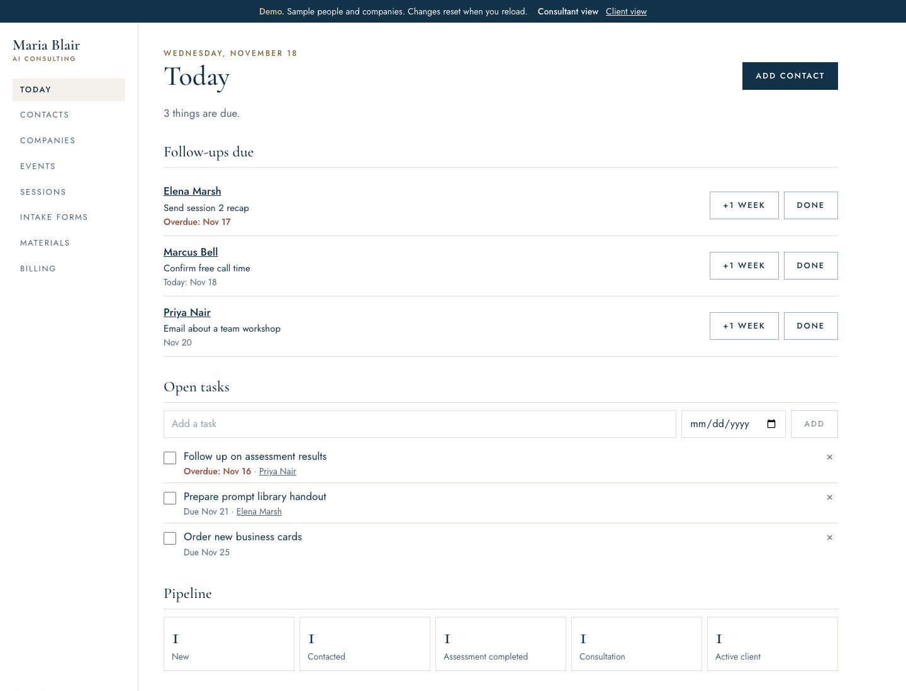

# Maria Blair AI · Client Management Platform

A React and TypeScript platform for running an independent AI consulting business: from a visitor's first assessment to client follow-ups, session planning, shared materials, and payment tracking.

**[Explore the sample-data demo](https://mariablairai.com/demo/admin)** · **[Visit the website](https://mariablairai.com)** · **[Architecture and product plan](docs/PLATFORM_PLAN.md)**

**React · TypeScript · TanStack Query · Supabase · Hono · Cloudflare Pages**

| Marketing landing page | Consultant dashboard |
| --- | --- |
| [](docs/screenshots/marketing-homepage.jpg) | [](docs/screenshots/crm-demo-today.jpg) |

*The live marketing website and the public CRM demo. All dashboard names and records are fictional. Click either screenshot to view it at full size.*

Built by **[Maria Blair](https://github.com/mashablair)** for her AI consulting practice. This project brings together product design, React application architecture, shared TypeScript domain rules, and client-facing workflows.

## The product

Consulting work creates a connected set of records: a person, their business, what they need help with, what was promised, what happens next, and what the client should be able to see. This project brings those workflows into one application while keeping internal working notes separate from client-facing content.

The public marketing site and the application share a visual identity, but have separate build responsibilities. The existing HTML marketing page stays intact while the React application handles the interactive workflows.

## Try it in two minutes

The **[admin demo](https://mariablairai.com/demo/admin)** uses fictional contacts and an in-memory data store. No account, API keys, or connection to the production database is required. Demo edits reset when the page reloads.

1. Start on **Today** to see overdue follow-ups, open tasks, and the client pipeline.
2. Open **Contacts** and explore a sample client's assessment, notes, sessions, and next actions.
3. Explore **Materials** and **Billing** to see how the operational workflows fit together.
4. Use the demo's client-view control to compare the internal workspace with the read-only client portal.

Use fictional information when exploring the demo. Real clients sign in through a separate authenticated flow.

## Key workflows

| Area | What it does |
| --- | --- |
| Assessment | Collects answers, applies shared scoring rules, and presents recommended next steps. |
| CRM | Connects contacts, companies, networking events, relationship stages, follow-ups, and internal notes. Includes CSV contact import. |
| Session planning | Tracks consultations and training sessions, preparation, outcomes, and client-visible summaries. |
| Materials | Organizes files and links, with explicit sharing to the appropriate client. |
| Billing | Tracks charges, payments, balances, product access, and Stripe payments that need manual matching. |
| Client portal | Shows the signed-in client's assessment history, shared recommendations, materials, session summaries, and products. |
| Free-call intake | Creates or updates a contact, records the visitor's message, creates a follow-up task, and sends confirmation and notification emails when services are configured. |

## Engineering highlights

- **One data contract, two implementations.** Screens use a typed repository interface rather than importing Supabase directly. Production uses Supabase; the portfolio demo uses an in-memory implementation of the same contract.
- **Shared rules across browser and API.** Domain types, validation, and assessment logic live in `shared/`, reducing drift between presentation and server-side handling.
- **Explicit access boundaries.** Database policies distinguish administration from client access. Internal notes are separate from information deliberately shared with a client.
- **Focused server responsibilities.** Hono handles privileged operations such as intake, assessment submission, email, and Stripe webhooks; ordinary authenticated application data uses Supabase with Row Level Security.
- **Testable payment handling.** The test suite covers webhook signatures, duplicate-event handling, matching, and product entitlements alongside application-level billing rules.
- **Preserved marketing delivery.** The assembly step copies the marketing page unchanged into the deployment output, with a build check for byte-for-byte equality.

Built for Maria Blair's consulting practice with AI-assisted development workflows. The repository's commit history records implementation contributions and co-authorship.

## Architecture

```text
Marketing site / public assessment
                │
                ▼
      React application + shared TypeScript rules
                │
        Typed repository interface
          ┌─────┴──────────────┐
          ▼                    ▼
  DemoRepository       SupabaseRepository
  Fictional data       Auth + Postgres + private storage
  In-memory only       Database access policies

Privileged requests → Hono API → server-side services
                                Email / Stripe event processing
```

| Path | Responsibility |
| --- | --- |
| `index.html`, `images/` | Static marketing page and visual assets. |
| `app/` | React application, routing, admin workflows, assessment, and client portal. |
| `app/src/data/` | Repository interface, query hooks, production adapter, and fictional demo data. |
| `server/`, `functions/api/` | Hono API and Cloudflare Pages Functions entry point. |
| `shared/` | Domain types, validation, scoring, and shared business rules. |
| `supabase/migrations/` | Database schema, access policies, and storage rules. |
| `tests/` | Domain, API, database-policy, demo, CSV, and build tests. |
| `scripts/` | Deployment assembly helpers. |

Routes include `/` (marketing), `/assessment`, `/login`, `/admin`, `/portal`, `/demo`, and `/api/*`.

## Local development

### Sample-data demo: no credentials required

```bash
npm install
npm run dev
```

Open **http://localhost:5173/demo/admin**.

### Connected application

Use [`.env.example`](.env.example) as the configuration reference:

- Put browser-safe Vite settings in `.env.local`.
- Put server-only settings in `.dev.vars` for Wrangler.
- Configure Supabase authentication, database migrations, and the required external services before testing connected workflows.
- Never commit either local environment file or any service-role key.

Open **http://localhost:5173/login** for the connected application. To build and serve the combined site and API locally:

```bash
npm run preview
```

Wrangler serves the assembled site at **http://localhost:8788**. `VITE_DEMO=1` is also available for a demo-only build.

## Tests and checks

```bash
npm run typecheck
npm test
npm run build
```

The suite includes assessment scoring and validation, CSV parsing, repository behavior, billing logic, API request handling, Stripe signatures, and database access rules using PGlite. The database tests exercise verified-email account linking, client isolation, and denial of access to internal records. Build tests check that the marketing page is preserved.

See [verification notes](docs/PORTFOLIO_CHECK.md) for the latest portfolio review and the scope of live checks.

## Security model

- Row Level Security and database-side admin checks protect application data; hiding a control in the UI is not the authorization boundary.
- Client account linking uses the email verified by Supabase rather than a contact ID supplied by the browser.
- Internal notes and operational records are admin-only. Client portal queries expose the intended client-facing data.
- Material files use a private storage bucket and short-lived download links.
- Server credentials belong in Cloudflare secrets, never browser code or Git.
- The public demo contains fictional data and does not need production credentials.

See the migrations and database-policy tests for the implementation. Deployment credentials and production configuration still need to be managed separately.

## Deployment and payments

Cloudflare Pages builds with `npm run build` and publishes `dist`. This repository is configured to deploy when `main` is updated.

Database changes belong in `supabase/migrations/`. Apply them to the intended configured project with `npm run db:push`; this command changes the target database and is not needed for the sample-data demo.

Paid-session booking uses a Stripe payment link; scheduling follows the checkout instructions. The free-call form uses the separate intake workflow described above. Offers and prices are business configuration, not demo guarantees.
